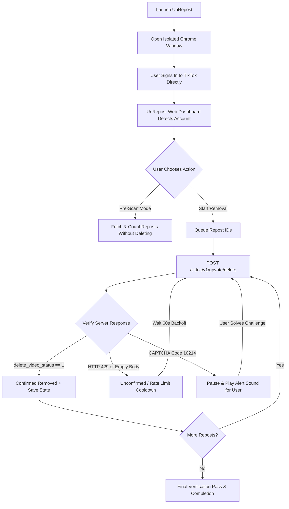

# UnRepost — Bulk TikTok Repost Remover

[](https://github.com/lansixxx/UnRepost/actions/workflows/ci.yml)
[](LICENSE)
[]()

**UnRepost** is an open-source, privacy-first desktop automation tool designed to bulk-remove your own TikTok reposts safely from your local machine.

- **Zero Passwords or Credentials Sent Anywhere**: You log in directly through an official browser window. UnRepost never sees or transmits your password.
- **100% Free & Open Source**: No subscriptions, no paid APIs, no third-party proxies, and zero telemetry.
- **Strictly Local**: Runs exclusively on `127.0.0.1` (loopback) with origin validation to prevent cross-site request forgery (CSRF).
- **Two-Step Verification**: Accurately differentiates confirmed removals from silent rate-limiting drops or empty server responses.
- **Safe Overnight Mode**: Human-paced randomized delays (3.0s – 5.5s), automatic CAPTCHA alerts, rate-limit cooldowns, and real-time state persistence.

---

## ⚠️ Important Disclaimer & Platform Limitations

> [!WARNING]
> - **Permanent Action**: Un-reposting is irreversible. Removed reposts cannot be automatically restored.
> - **Platform Boundaries**: TikTok has no public API for repost management. This tool interacts with authenticated web endpoints that are subject to TikTok's anti-bot protections, rate limits, and interface updates.
> - **No Guarantees**: This tool cannot guarantee 100% removal in every scenario or immunity from temporary account actions/blocks. TikTok may temporarily limit account actions after a certain volume of deletions in a 24-hour period.
> - **Independent Project**: UnRepost is not affiliated with, authorized, maintained, sponsored, or endorsed by TikTok, ByteDance, or any of their affiliates.

---

## 🚀 Getting Started

### Method 1: macOS Desktop App (Double-Click)

For regular users on macOS who want a simple graphic application without running terminal commands:

1. Download the latest release from the [Releases](https://github.com/lansixxx/UnRepost/releases) page.
2. Unpack the archive to find `UnRepost.app`.
3. Double-click `UnRepost.app` to launch.
   - *Note on macOS Gatekeeper*: Because this is a free, non-notarized open-source build, macOS may display a notice on first launch: *"Apple could not verify the developer"*.
   - To open: Right-click (or Control-click) `UnRepost.app`, select **Open**, and click **Open** in the dialog. Alternatively, run `xattr -cr /path/to/UnRepost.app`.
4. Ensure Google Chrome or Chromium is installed. UnRepost will open an isolated desktop window connected to your local session.

### Method 2: Running from Source (macOS, Windows, Linux)

For developers or users on Windows and Linux:

#### Prerequisites
- [Node.js](https://nodejs.org/) (version 20 or higher)
- Google Chrome or Chromium installed

#### Steps
```bash
# Clone the repository
git clone https://github.com/lansixxx/UnRepost.git
cd unrepost

# Install dependencies
npm install

# Run automated tests
npm test

# Start the application
npm start
```
Open `http://127.0.0.1:3210` in your web browser.

---

## 📖 How It Works



1. **Sign In**: Log into your TikTok account in the browser window using QR code, email, phone, or third-party OAuth. UnRepost reads the session locally without capturing credentials.
2. **Preview (Pre-Scan)**: Click **"Scan Reposts First (Preview)"** to read your current repost queue and count total items without altering any data.
3. **Execute Removal**: Check the confirmation box and click **"Confirm & Start Removal"**. UnRepost processes items one-by-one with human-like delays.
4. **Pause / Resume**: You can pause the process at any time. Runtime progress is continuously saved to local disk, so you can safely stop and resume later.
5. **Sign Out & Clean**: Click **"Sign Out & Clear Session"** to delete all local cookies, cache, and session files from your machine.

---

## 🔒 Security & Privacy Architecture

- **Local Storage Only**: Your session cookies and persistent state are stored in standard OS user directories:
  - macOS: `~/Library/Application Support/UnRepost`
  - Windows: `%APPDATA%\UnRepost`
  - Linux: `~/.config/unrepost`
- **Loopback Enforcement**: The internal HTTP and WebSocket servers bind strictly to `127.0.0.1`. Requests carrying external host headers or cross-origin headers are rejected with `403 Forbidden`.
- **Zero Third-Party Calls**: Network traffic occurs solely between your local machine and `tiktok.com`. There are no analytics, remote error reporting, or developer pings.
- **Export Control**: CSV and JSON audit logs are downloaded directly to your local browser downloads folder only after explicit user confirmation.

Read the full [Privacy Policy](PRIVACY.md) and [Security Policy](SECURITY.md).

---

## 🧪 Testing & Verification

UnRepost includes an automated unit test suite verifying response evaluation, rate-limit detection, CSRF protection, and state tracking:

```bash
npm test
```

---

## 🛠️ Building the macOS App Bundle from Source

To build `UnRepost.app` locally:

```bash
npm run build:mac
```
The compiled bundle will appear in `dist/UnRepost.app`.

---

## 📄 License

This project is licensed under the [MIT License](LICENSE).
TikTok is a registered trademark of ByteDance Ltd. UnRepost is an independent open-source tool.
